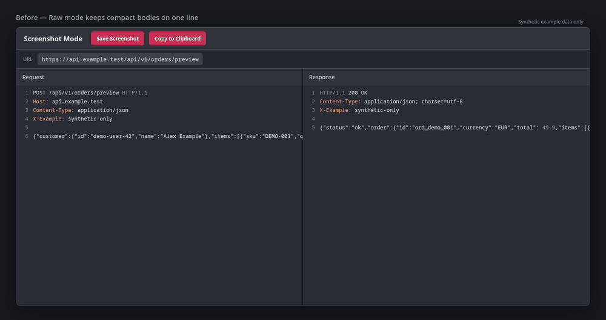
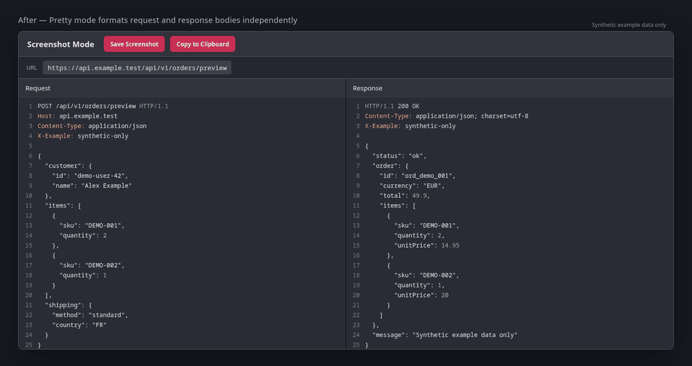

<div align="center">
  

  <br />
  <br />
  <a href="https://github.com/caido-community" target="_blank">Github</a>
  <span>&nbsp;&nbsp;•&nbsp;&nbsp;</span>
  <a href="https://developer.caido.io/" target="_blank">Documentation</a>
  <span>&nbsp;&nbsp;•&nbsp;&nbsp;</span>
  <a href="https://links.caido.io/www-discord" target="_blank">Discord</a>
  <br />
  <hr />
</div>

# Screenshot Mode

Create pretty screenshots of your requests and response right into Caido. No external tools, no pain. Start sharing!


## Pretty and Raw views

Request and response bodies can be shown independently as Raw or Pretty. The mode is
stored in the template, and **Raw is the default** for both sides so that existing
highlight and redaction rules keep matching the text on the wire.

Pretty mode formats JSON, XML, and URL-encoded form bodies for the screenshot while
leaving the stored HTTP message untouched. XML is re-indented without collapsing inline
text. Bodies that are malformed, binary, unsupported, or larger than 1 MiB are shown
as Raw.

| Raw | Pretty |
| --- | --- |
|  |  |

The comparison uses synthetic example data only.

## Installation

### From Plugin Store

1. Install via the Caido Plugin Store
2. Navigate to `Replay`, open a tab and click on `Screenshot`
3. Configure your overlay and save the file

### Manual Installation

1. Install dependencies:

   ```bash
   pnpm install
   ```

2. Build the plugin:

   ```bash
   pnpm build
   ```

3. Install in Caido:
   - Upload the `dist/plugin_package.zip` file by clicking "Install Package" in Caido's plugin settings
